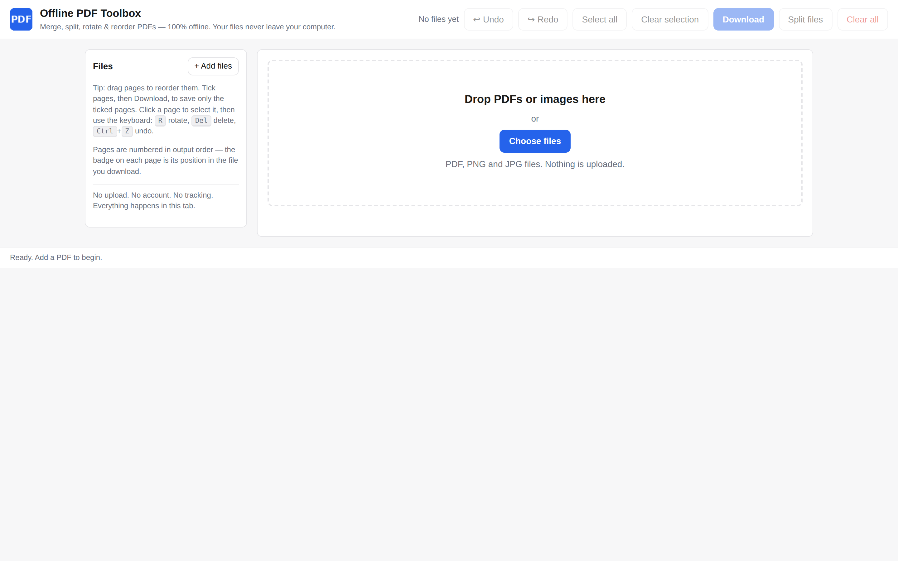
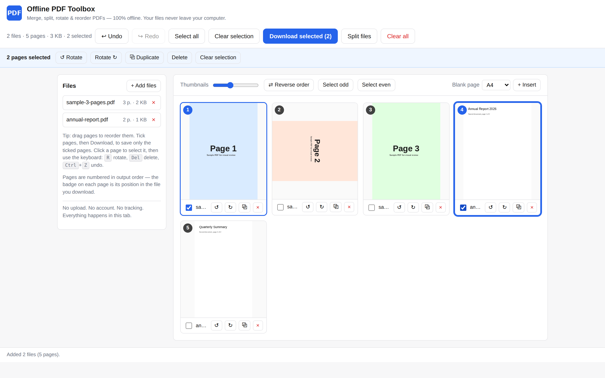

# Offline PDF Toolbox

Merge, split, rotate & reorder PDFs — 100% offline. Your files never leave your computer.

> A browser extension (Chrome / Edge, Manifest V3) and a web app that do the everyday PDF jobs — merge, split, rotate, delete, duplicate and reorder pages — entirely in your browser. No upload, no account, no tracking, no permissions, no limits.





**Try it now, no install:** https://eslam-tohamy2026.github.io/offline-pdf-toolbox/app/

## Why another PDF tool?

Every popular PDF tool either uploads your files to a server (iLovePDF, Smallpdf) or charges for basic features. This one does neither:

- **100% offline** — files are processed in your browser tab and never sent anywhere.
- **Free, forever** — merge, split, rotate, delete, reorder, duplicate, blank pages. No paywall, no account, no daily task limit, no file-size cap.
- **Zero permissions** — the extension asks for nothing: no access to your browsing, no host permissions.
- **Visual pages** — see every page as a thumbnail and drag it where it belongs. Each page wears its output position as a badge, so what you see is the order you download.
- **Undo** — every change (delete, reorder, rotate, duplicate, add) can be undone with Ctrl+Z.

## What it does

| Job | How |
|---|---|
| Merge | Add several PDFs — they join in the order shown |
| Split / extract | Tick pages, then Download — only ticked pages are saved |
| Split into files | **Split files** downloads every page as its own PDF (`report-01.pdf`, `report-02.pdf`, …) |
| Rotate | ↺ / ↻ on any page, 90° steps — or rotate all ticked pages at once |
| Delete | × on any page, or delete all ticked pages at once |
| Duplicate | ⧉ copies a page right after the original |
| Reorder | Drag any page thumbnail to a new place — drop on the left half to insert before, the right half to insert after, or on empty space to move it to the end. **⇄ Reverse order** flips the whole document |
| Insert blank page | A4, Letter or A5, inserted after the selected page (or at the end) |
| Images as pages | Drop PNG/JPG scans in — each becomes a page in the output PDF |
| Select odd / even | One click ticks pages 1, 3, 5… or 2, 4, 6… |
| Undo / redo | Ctrl+Z / Ctrl+Shift+Z (or the Undo / Redo buttons) — up to 50 steps |
| Password-protected PDFs | Rejected with a clear message (they cannot be processed offline without the password) |
| Broken / non-PDF files | Rejected with a clear message, nothing crashes |

## Keyboard shortcuts

| Keys | Action |
|---|---|
| `Ctrl/⌘ + Z` / `Ctrl/⌘ + Shift + Z` | Undo / redo |
| `Ctrl/⌘ + A` | Select all pages |
| `Delete` / `Backspace` | Delete the selected pages (or the active page) |
| `R` / `Shift + R` | Rotate the selected pages (or the active page) right / left |
| `←` / `→` | Move to the previous / next page |

## Use it

1. Drop PDF or image files onto the page (or click **Choose files**).
2. Every page appears as a thumbnail, numbered in output order. Drag pages to reorder them.
3. Per page: **↺ / ↻** rotate, **⧉** duplicate, **×** delete, **☐** tick to select.
4. **Download** saves all pages in the order shown. Tick some pages first and Download saves only those (that's the split/extract). **Split files** saves each page as its own file.
5. **Clear all** starts over. Nothing is kept after the tab closes.

## Install as an extension (load unpacked)

```bash
git clone https://github.com/eslam-tohamy2026/offline-pdf-toolbox.git
cd offline-pdf-toolbox
```

1. Open `chrome://extensions` (or `edge://extensions`).
2. Turn on **Developer mode** (top right).
3. Click **Load unpacked** and choose this folder.
4. Click the extension icon in your toolbar — the toolbox opens in a tab.

The same app runs on the web with no install at all: https://eslam-tohamy2026.github.io/offline-pdf-toolbox/app/

## How it compares

Honest comparison, checked November 2026. This tool does five jobs well; it does not try to do fifty.

|  | Offline PDF Toolbox | iLovePDF (free) | PDF24 | Stirling PDF | PDF Arranger |
|---|---|---|---|---|---|
| Merge / split / rotate / reorder | Yes | Yes | Yes | Yes | Yes |
| Works with no install | Yes — web app | Yes — web app | Yes — web app | No — needs Docker/server | No — desktop install |
| Files leave your computer | Never | Uploaded, kept up to 2 h | Uploaded (web tools) | Stay on your server | Never |
| Account / paywall / limits | None | 15–100 MB per task, batch limits, Premium $5–9/mo | Free, no daily caps | Free core; automation capped on v3 free tier | None |
| Undo / redo | Yes | No | No | No | Yes |
| Duplicate / blank pages | Yes | No | Partial | Yes | Yes |
| Images as pages | Yes (PNG/JPG) | Yes | Yes | Yes | Yes |
| Compress, OCR, convert, sign, edit text | No | Yes | Yes | Yes | No |

If you need compression, OCR, Office conversion or signing, use Stirling PDF (self-hosted) or PDF24 — they are genuinely good at those. If you need to merge, split, rotate and reorder pages without uploading a sensitive document anywhere, this tool does that with no account, no install and no limits.

## Privacy

- No server. No account. No analytics. No tracking.
- The extension requests **zero permissions** (`"permissions": []` in `manifest.json`).
- The shipped code makes no network requests at all — no `fetch`, no `XMLHttpRequest`, no third-party scripts. The only libraries are `pdf-lib` and `pdf.js`, vendored locally in `app/vendor/`.
- Files live only in the tab's memory and are gone when the tab closes.

## Develop & test

```bash
npm install          # dev-only: pdf-lib, pdfjs-dist, jsdom (for tests)
npm test             # 20 checks: PDF operations + UI tests in jsdom
```

The PDF operations in `app/pdfops.js` are written so the same file runs in the browser and in Node — the tests exercise the real code. The UI tests drive the real app in jsdom (thumbnails can't render there, so they assert the app degrades to placeholders). A real-browser check (headless Chromium, local HTTP server) also runs the app end to end with real PDFs: merge, rotate, select, drag-reorder, Delete, Ctrl+Z, download and split — 16 checks, zero console errors.

## Known limits

- Password-protected PDFs can't be opened (by design — there is nowhere to send the password to).
- Very large files (hundreds of MB) work but thumbnails take a while; there is no hard size cap.
- No compression, OCR, text editing, form filling or signing — see the comparison above.
- "Split files" downloads several files at once; your browser may ask once whether to allow multiple downloads.

## Need a custom tool or a PDF workflow automated?

Hire me on Fiverr: https://www.fiverr.com/eslam_engineer — SolidWorks 3D modelling, PDF/sketch → AutoCAD DWG & DXF, CNC/laser-cut files ready for production, Excel VBA automation.

## Licence

MIT — see [LICENSE](LICENSE). Free for personal and commercial use.
